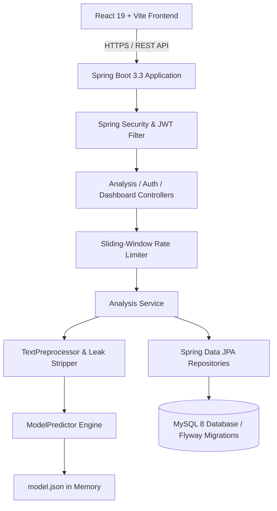

# Fake News Detection on Social Media

[](https://www.oracle.com/java/)
[](https://spring.io/projects/spring-boot)
[](https://react.dev/)
[](https://vitejs.dev/)
[](https://tailwindcss.com/)
[]()
[]()
[]()

A full-stack, production-quality academic research application engineered to analyze news content and social-media statements for stylistic and lexical markers of misinformation. Features an end-to-end **100% pure Java Machine Learning pipeline** (TF-IDF + L2 Logistic Regression), Spring Boot 3.3 REST API with JWT security, Flyway database migrations for MySQL 8, and an accessible React 19 frontend with real-time explainability.

---

## 1. Project Abstract & Objectives

The proliferation of unverified content and misleading claims on digital social platforms presents significant challenges to public discourse. This project provides an educational and analytical tool that evaluates the stylistic composition of submitted articles against empirical news corpora.

### Core Objectives:
1. **Explainable Classification:** Provide not just a categorical prediction, but the specific top lexical features (vocabulary weights) that pushed the score toward genuine or fabricated patterns.
2. **Cautious Decision Rules:** Reject false certainty by establishing an explicit **Uncertain Zone (0.40 - 0.60)** requiring human verification.
3. **SSRF-Safe Input Collection:** Accept article headlines, bodies, and attribution URLs without performing dangerous server-side fetching.
4. **Reproducible Java-Only ML:** Avoid Python dependency overhead by executing text cleaning, wire leakage removal, feature extraction, and logistic regression training entirely in standard Java.
5. **Secure Multi-User Archive:** Allow authenticated users to securely track, inspect, and delete their own historical analyses with strict data isolation.

> [!IMPORTANT]
> **Fundamental Academic Principle:** A machine-learning text classification model measures statistical resemblance to historical training data. It is **not** proof of factual truth. Satire, breaking events, and topic distribution shifts can lead to misclassification. Users are always guided to cross-examine claims with established primary sources and independent fact-checkers.

---

## 2. System Architecture



---

## 3. Seven-Stage Detection Workflow

```
News Text / Social Post
   │
   ▼
[Stage 1: Input Collection & Sanitization] ──> Length (10-10,000 chars), regex URL format check (no SSRF)
   │
   ▼
[Stage 2: Text Preprocessing & Cleaning]   ──> Unicode normalization, strip wire headers (Reuters/AP)
   │
   ▼
[Stage 3: Feature Extraction (TF-IDF)]    ──> Sublinear term frequency, smoothed IDF across 6,000 features
   │
   ▼
[Stage 4: Trained Classifier Evaluation]   ──> L2 Logistic Regression dot product + bias
   │
   ▼
[Stage 5: Model Scoring]                   ──> Sigmoid transfer function producing score (0.00 - 1.00)
   │
   ▼
[Stage 6: Tri-Zone Decision Verdict]       ──> Likely Genuine (<=0.40), Uncertain (0.40-0.60), Likely Fake (>=0.60)
   │
   ▼
[Stage 7: Explainability & Guidance]       ──> Top 5 +/- terms + interactive fact-checking checklist
```

---

## 4. Technology Stack

### Backend
- **Language:** Java 21 (Long-Term Support).
- **Framework:** Spring Boot 3.3.4 (Spring Web, Spring Data JPA, Spring Security, Bean Validation, Actuator).
- **Security:** Stateless JWT authentication (jjwt 0.12.6), BCrypt password hashing.
- **API Documentation:** OpenAPI 3 / Swagger UI (`springdoc-openapi-starter-webmvc-ui` 2.6.0).
- **Migrations:** Flyway MySQL migrations.
- **Build Tool:** Maven 3.9+ with Maven Wrapper.

### Machine Learning (100% Java)
- **Classifier:** L2-Regularized Logistic Regression trained with Stochastic Gradient Descent (SGD) in Java.
- **Vectorization:** TF-IDF with sublinear term frequency scaling (`1 + ln(count)`) and smoothed IDF (`ln((1 + N)/(1 + df)) + 1.0`).
- **Feature Selection:** Top 6,000 informative n-gram tokens (filtering doc frequency < 4 and > 70%).
- **Leakage Prevention:** Regex stripper removing wire signatures (`(Reuters)`, `(AP)`, `Associated Press`).
- **Data Deduplication:** Strict hash fingerprinting removing duplicate articles.

### Frontend
- **Framework:** React 19 with Vite 8.
- **Routing:** React Router 7.
- **HTTP Client:** Axios with centralized interceptors.
- **Styling:** Tailwind CSS 3.4 (Editorial Slate & Teal theme).
- **Icons:** Lucide React.
- **Testing:** Vitest + React Testing Library + jsdom.

### Database & Infrastructure
- **Relational Storage:** MySQL 8.0 (InnoDB engine, UTF-8).
- **Testing In-Memory Database:** H2 Database (for zero-dependency unit and integration testing).
- **Containerization:** Multi-stage Dockerfiles and Docker Compose orchestration.
- **Hosting Blueprint:** Render Blueprint configuration (`render.yaml`).

---

## 5. Machine Learning Evaluation Results

Trained and evaluated using an 80/20 stratified split (fixed random seed = 42) on the public George McIntire Fake and Real News dataset:

| Metric | Measured Value | Description |
| :--- | :--- | :--- |
| **Accuracy** | **93.33%** | Overall test set correctness |
| **Precision** | **91.99%** | Accuracy of Fake predictions |
| **Recall** | **94.91%** | Sensitivity in identifying fabricated articles |
| **F1-Score** | **0.9343** | Harmonic mean of precision and recall |
| **Total Samples** | 6,297 | Distinct articles after duplicate removal |
| **Training Split** | 5,037 | 2,515 Fake / 2,522 Genuine |
| **Test Split** | 1,260 | 629 Fake / 631 Genuine |

### Confusion Matrix on Held-Out Test Set (1,260 articles):
- **True Positives (Fake &rarr; Fake):** 597
- **False Positives (Genuine &rarr; Fake):** 52
- **True Negatives (Genuine &rarr; Genuine):** 579
- **False Negatives (Fake &rarr; Genuine):** 32

---

## 6. Database Schema Design

### `users` Table
| Column | Type | Constraints | Description |
| :--- | :--- | :--- | :--- |
| `id` | BIGINT | PRIMARY KEY, AUTO_INCREMENT | Unique user identifier |
| `name` | VARCHAR(100) | NOT NULL | User's display name |
| `email` | VARCHAR(150) | NOT NULL, UNIQUE, INDEXED | Email address (login identifier) |
| `password_hash` | VARCHAR(255) | NOT NULL | BCrypt password hash |
| `role` | VARCHAR(50) | NOT NULL, DEFAULT 'ROLE_USER' | User authorization role |
| `created_at` | TIMESTAMP | DEFAULT CURRENT_TIMESTAMP | Account creation timestamp |

### `analyses` Table
| Column | Type | Constraints | Description |
| :--- | :--- | :--- | :--- |
| `id` | BIGINT | PRIMARY KEY, AUTO_INCREMENT | Unique analysis record ID |
| `user_id` | BIGINT | NOT NULL, FOREIGN KEY (users.id) | Owner of the analysis record |
| `headline` | VARCHAR(500) | NULL | Optional headline or title |
| `text` | LONGTEXT | NOT NULL | Submitted news text (up to 10k chars) |
| `source_url` | VARCHAR(1000) | NULL | Optional source attribution link |
| `label` | VARCHAR(50) | NOT NULL | Predicted label (Fake/Genuine/Uncertain) |
| `score` | DOUBLE | NOT NULL | Numerical model score (0.0000 - 1.0000) |
| `model_version` | VARCHAR(50) | NOT NULL | Version of model utilized |
| `created_at` | TIMESTAMP | DEFAULT CURRENT_TIMESTAMP | Submission timestamp |

**Indexes:**
- `idx_users_email` on `users(email)`
- `idx_analyses_user_created` on `analyses(user_id, created_at DESC)`

---

## 7. Automated Testing Summary

All test suites execute without failure:
- **Backend Tests:** 27 tests in 6 test suites (`mvn test`) &rarr; **100% PASS**
  - Text cleaning and wire leak stripper tests.
  - ModelPredictor inference, uncertain zone, and missing model exception tests.
  - RateLimiterService throttling tests.
  - JwtTokenProvider generation and claims tests.
  - AuthService registration and BCrypt hashing tests.
  - AnalysisService user ownership and authorization tests.
  - MockMvc integration tests for authentication and analysis workflows.
- **Frontend Tests:** 11 component and state tests (`npm test`) &rarr; **100% PASS**
  - Form validation, character counter, and sample article population.
  - Result rendering, label badge styles, and feature explainability terms.
  - History table rendering, detail modals, and deletion actions.

---

## 8. License & Attribution

- **Dataset Source:** George McIntire's open public Fake and Real News dataset.
- **License:** Open Academic Educational Project.
